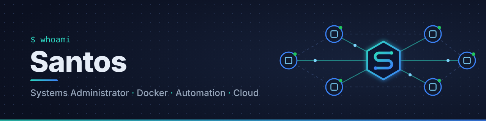

  

### Hi, I'm Santos 👋

Systems Administrator focused on keeping large fleets of environments **running, observable and automated**.
I spend my days with containers, reverse proxies, monitoring, identity and networks, and I automate everything I have to do twice.

- 🐳 Running and operating **Docker Swarm** clusters
- 📈 Building monitoring and alerting
- 🔐 Managing identity and SSO
- ⚙️ AAutomating infrastructure with **Ansible**, **Terraform**, Bash and PowerShell
- 🌱 Always learning: in **continuous training** to keep my skills up to date

### 🧰 Toolbox

**Platform & containers** 

**Automation & CI/CD** 

**Observability & identity** 

**Cloud & networking** 

### 📫 Contact

